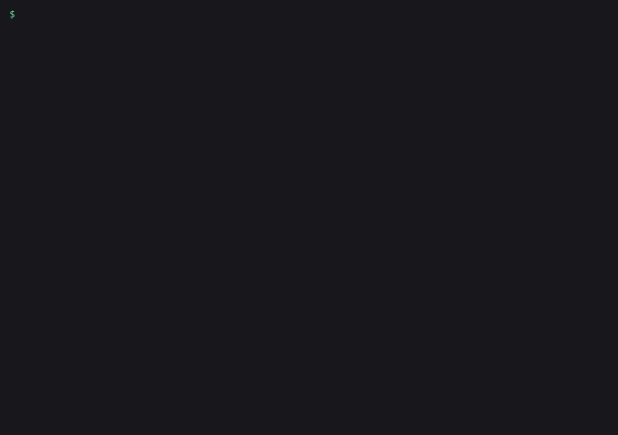

# amagi-trace

Point `amagi-trace` at a Playwright `trace.zip`, or at your whole `test-results/` folder, and it writes one markdown file per failed test: the steps with pass or fail, the failing locator and assertion, console errors, failed network calls, and the page's DOM text and screenshot from the moment of failure. Your AI agent can then fix a red CI run without anyone opening the trace viewer.



When you ask Claude Code or Codex to fix a failing E2E test, it usually sees a stack trace and nothing else. It does not see that the page showed "Error 500", that the checkout call returned a 500, or that the button it is about to re-locate was never on the page. The trace has all of that. amagi-trace pulls it out as plain text.

## Install

```bash
pipx install amagi-trace
```

Or from source: `pipx install git+https://github.com/amagilabs/amagi-trace`.

Python 3.9 or newer. No dependencies. It reads the finished trace files only; it never starts Playwright or a browser.

## Usage

```bash
amagi-trace test-results/                   # ./trace-md/index.md + one .md per failed test
amagi-trace path/to/trace.zip --stdout      # print one report, write nothing
amagi-trace test-results/ -o out --all      # include passing tests too
amagi-trace test-results/ --source-dir .    # trace came from CI: read the spec files from here
```

Then tell your agent: "Read trace-md/index.md and fix the failing tests."

Make sure Playwright records traces. In `playwright.config.ts`, set `use: { trace: 'retain-on-failure' }`. In CI, upload `test-results/` as an artifact and download it before running amagi-trace.

### Try it on the bundled example

`examples/test-results/` holds real traces from a tiny checkout page with four tests, three of them failing. The spec and page are in `examples/shop-e2e/`.

```bash
amagi-trace examples/test-results -o trace-md
```

```
amagi-trace: read 4 trace(s): 3 failed, 1 passed. Wrote 3 file(s) to trace-md/
  [FAILED] checkout shows confirmation: Error: expect(locator).toHaveText(expected) failed
  [FAILED] coupon call is aborted and page throws: Error: expect(locator).toHaveText(expected) failed
  [FAILED] missing button click times out: TimeoutError: locator.click: Timeout 1500ms exceeded.
```

The report for the first test says what Playwright could not say in one line. The test expected "Payment confirmed" and the page showed "Error 500", because the charge call came back with a 500:

```
## Failed network calls

- `POST https://shop.test/api/charge` -> **500 Internal Server Error** at +1.0s
  - response body: `boom`

## Page at the moment of failure

- Target element: `<p id="status">Error 500</p>`

# Checkout
[input] type=email placeholder='you@example.com' value='buyer-one'
Email
[button] Pay now
Error 500   <-- TARGET
```

## What each report contains

- **Failure:** the runner's error with the colour codes removed, plus Playwright's call log.
- **Failing step:** the step, the locator as written in your test, the internal selector, and the spec file and line. **Test source** shows the lines around it.
- **Steps:** every step you wrote, marked `[ok]` or `[FAIL]` with its duration. Fixture and hook steps are left out unless you pass `--hooks`.
- **Console and page errors:** console errors and warnings, and uncaught exceptions. Repeated lines are folded into one with a count.
- **Failed network calls:** 4xx and 5xx responses and requests that got no response, with the request body and the start of a text response body.
- **Page at the moment of failure:** a readable outline of the DOM from the snapshot taken at the failing step. Hidden elements are skipped, input values are shown, and `<-- TARGET` marks the element the step was aimed at.
- **ARIA snapshot and screenshot:** Playwright's own `error-context.md` and failure screenshot when they sit next to the trace. If not, the last recorded frame is used.

Options: `--max-dom N`, `--max-steps N`, `--all-console`, `--hooks`, `--no-screenshots`, `-o DIR`.

## Use it from Claude Code

The repo ships a Claude Code skill at `.claude/skills/amagi-trace/SKILL.md`. Copy that folder into your project's `.claude/skills/` or into `~/.claude/skills/`, and Claude will reach for the tool whenever you hand it a trace or a red Playwright run.

## Limits

- Only the main frame's DOM is shown. Iframe content is not rendered.
- The DOM section is a text outline, not full HTML.
- It needs a trace. A run with `trace: 'off'` has nothing to read.
- Built and tested against traces from Playwright 1.63 (JavaScript test runner, Chromium). The trace format is Playwright's internal one and can change between versions.

## How it compares

- **Playwright Trace Viewer** is the best way for a person to explore a trace. It is a GUI, so an agent cannot use it. amagi-trace is the text version for the agent.
- **Playwright MCP** lets an agent drive a live browser. It does not read a trace from a run that already finished in CI.
- **Hosted test dashboards** such as Currents show results in a web app. amagi-trace runs offline on files you already have and costs nothing.

If this saved you time, a star helps others find it.

## More from AmagiLabs

- [amagilabs](https://github.com/amagilabs): other small open source tools from the same lab.
- [amagi-site-diff](https://github.com/amagilabs/amagi-site-diff): crawl two versions of a site with Playwright and write pixel and text diffs an AI agent can read.
- [amagi-env-check](https://github.com/amagilabs/amagi-env-check): diff `.env`, `.env.example` and your live environment without printing a value.
- [amagi-skill-lint](https://github.com/amagilabs/amagi-skill-lint): lint Claude Code SKILL.md and subagent files.
- [amagi-mcp-probe](https://github.com/amagilabs/amagi-mcp-probe): smoke-test an MCP server's tools in CI.

## License

MIT, see [LICENSE](LICENSE). Copyright (c) 2026 Amagisolutionsgroup, Inc. (AmagiLabs).
